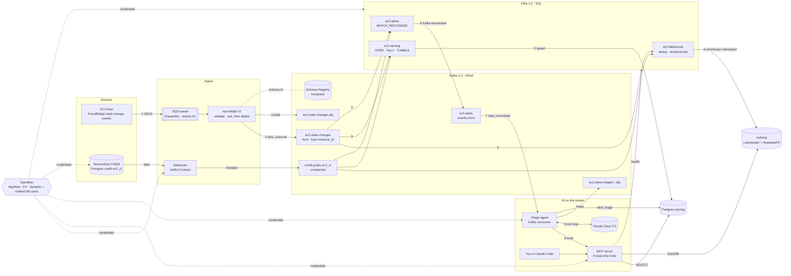

# Real-time EC2 inventory: learning stream processing

Your batch pipeline snapshots `aws ec2 describe-instances` every 2 hours. This project rebuilds it as a
**streaming** pipeline: every EC2 state change flows through SQS, Kafka and Flink and lands in Iceberg, a Postgres
serving table and an alert topic within seconds. An AI agent then triages the alerts with MCP tools, and every
credential comes from OpenBao (the open-source Vault).

It is built to teach, so read the lessons in order and run the code alongside them.



The numbered steps follow one EC2 state change end to end; [docs/architecture.md](docs/architecture.md) explains each step
with its latency and delivery guarantee, and [docs/architecture.html](docs/architecture.html) is the full drawing
(download and open it in a browser).

## Read in this order

| # | Lesson | You will understand |
|---|--------|---------------------|
| 00 | [From batch to streaming](docs/00-batch-to-streaming.md) | The mental model, mapped to Spark and Iceberg concepts you already know |
| 01 | [The 2026 landscape](docs/01-the-2026-landscape.md) | Which tools companies hire for, and why this stack |
| 02 | [Kafka](docs/02-kafka.md) | Logs, partitions, keys, consumer groups, offsets, retention, compaction |
| 03 | [Events and contracts](docs/03-events-and-contracts.md) | Event design, Avro, Schema Registry, compatibility, DLQs |
| 04 | [SQS and the bridge](docs/04-sqs-and-the-bridge.md) | Queues vs logs, at-least-once, visibility timeouts, redrive |
| 05 | [CDC with Debezium](docs/05-cdc-with-debezium.md) | Turning a database into a stream |
| 06 | [Flink fundamentals](docs/06-flink-fundamentals.md) | State, checkpoints, exactly-once, event time, watermarks |
| 07 | [The Flink SQL jobs, line by line](docs/07-flink-sql-walkthrough.md) | Dedup, temporal joins, windows, MATCH_RECOGNIZE, upserts |
| 08 | [The streaming lakehouse](docs/08-streaming-lakehouse.md) | Iceberg as a streaming sink, small files, compaction |
| 09 | [Secrets with OpenBao](docs/09-secrets-with-openbao.md) | How Vault-style secret management works |
| 10 | [Agents on streams](docs/10-agents-on-streams.md) | MCP over live data, event-driven agents, Flink's own AI features |
| 11 | [Operating in production](docs/11-operating-in-production.md) | Kubernetes, AWS, monitoring, upgrades, backfills |
| 12 | [Exercises](docs/12-exercises.md) | Break things on purpose and watch the system cope |

## Run it

Needs Docker with about **8 GB free** for this stack (Docker Desktop: Settings > Resources > Memory; 12 GB total is
comfortable). Stop other stacks first; this one runs on its own.

```bash
docker compose up -d --build
```

The first start takes a few minutes: it builds images, initialises OpenBao, creates topics, tables and the
Debezium connector, then submits three Flink jobs. Watch it settle:

```bash
docker compose ps -a
```

`bao-bootstrap`, `init` and `submit-jobs` should show `Exited (0)`; everything else `Up`.

To run the triage agent too, put your key in `.env` (gitignored; see `.env.example`) and start the `agent` profile.
It costs money per alert (capped at 20 an hour by default):

```bash
docker compose --profile agent up -d
```

| What | Where |
|------|-------|
| Kafka UI: topics, messages, lag, schemas, connectors | http://localhost:18080 |
| Flink UI: jobs, checkpoints, backpressure, watermarks | http://localhost:18081 |
| OpenBao UI (token: lesson 09 shows how to get it) | http://localhost:18200/ui |
| Lakekeeper (Iceberg catalog) UI | http://localhost:18181/ui |
| MCP server (Streamable HTTP) | http://localhost:18002/mcp |
| Postgres (serving, cmdb) | localhost:15432 |
| Kafka from your laptop | localhost:19092 |

Stop it, keeping all data:

```bash
docker compose --profile agent stop
```

Delete everything, data included:

```bash
docker compose --profile agent down -v
```

## Code map

| Path | What it is |
|------|------------|
| [`services/ingest/simulator.py`](services/ingest/simulator.py) | Fake AWS + ServiceNow: EC2 lifecycle events into SQS, CMDB edits into Postgres, with duplicates, late and malformed events |
| [`services/ingest/events.py`](services/ingest/events.py) | The event contract: EventBridge JSON in, validated record out |
| [`services/ingest/sqs_bridge.py`](services/ingest/sqs_bridge.py) | SQS to Kafka, at-least-once, idempotent producer, DLQ |
| `jobs/*.sql` | The three Flink SQL jobs and the shared session setup |
| [`jobs/submit.sh`](jobs/submit.sh) | Submits jobs, filling secrets from OpenBao-rendered files |
| [`services/mcp_server/server.py`](services/mcp_server/server.py) | MCP tools over live state, history, alerts and pipeline health |
| [`services/agent/triage.py`](services/agent/triage.py) | Kafka consumer that triages each alert with Claude and the MCP tools |
| [`services/common/secrets.py`](services/common/secrets.py) | OpenBao client: AppRole login, KV, dynamic and rotated DB credentials |
| [`scripts/bao_bootstrap.py`](scripts/bao_bootstrap.py) | Initialises, unseals and configures OpenBao |
| [`scripts/init_streaming.py`](scripts/init_streaming.py) | Buckets, Iceberg tables, topics, schema, Debezium connector |
| [`stack/`](stack) | Config for Postgres, ElasticMQ, Debezium, Flink, OpenBao |
| [`tests/`](tests) | Unit tests for the contracts (`uv run pytest`) |

Run the tests without Docker:

```bash
mise exec -- uv run pytest -q
```

## Relation to ../learn-ai-agent

That project is the batch side: describe-instances snapshots in Iceberg, a REST API and an MCP server. This one
uses the same lakehouse pieces (SeaweedFS, Lakekeeper, Iceberg REST, DuckDB) and the same MCP SDK and coding
conventions, but runs as its own stack on its own ports, so the two never depend on each other.
