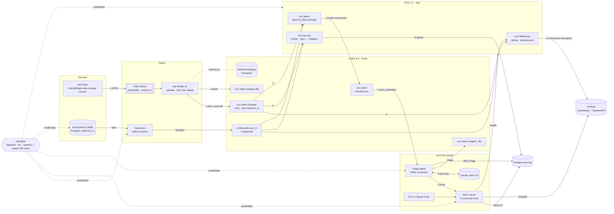

# Architecture

The full diagram, with the numbered trace of one event and the secrets matrix, is
[architecture.html](architecture.html) (open it in a browser; also published at https://claude.ai/artifact/G6uwaopNAM6WmHrFUShyXR). This is the same picture as a Mermaid diagram, which
renders in VS Code and GitHub.

| # | Step | Latency | Guarantee |
|---|------|---------|-----------|
| 1 | AWS emits the state change; EventBridge delivers it to SQS | < 1 s | at-least-once |
| 2 | Bridge validates, writes Avro to Kafka, deletes from SQS after the ack | < 1 s | at-least-once |
| 3 | Flink reads it; duplicates dropped on `event_id` | ms | exactly-once state |
| 4 | Joined with the CMDB as of event time, committed to Iceberg | 30-60 s | exactly-once |
| 5 | Upserted into `instance_current_state` | 1-2 s | idempotent upsert |
| 6 | Flapping pattern completes; alert published in a Kafka transaction | 30-60 s | exactly-once |
| 7 | Agent reads committed alerts only | ms | at-least-once + idempotent writes |
| 8 | Agent investigates through MCP tools | seconds | read-only |
| 9 | Claude returns a structured triage; offset committed after it is stored | ~30 s | |
